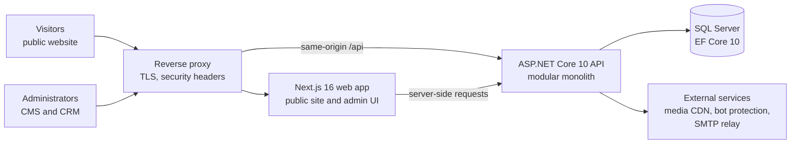

# Thuý Nga Wedding & Event — Production Case Study

A documentation-only case study of a production web platform I delivered end to end for a wedding and event decoration business in Hanoi, Vietnam. The platform combines a public Vietnamese-language website with an internal CMS and CRM that follows each deal from first enquiry to a completed event: leads, customers, events, appointments, quotations with PDF output, and payment tracking.

**This repository contains no application source code.** The production source code is private. This repository describes the product, architecture, engineering decisions and delivery practice at a level that is safe to share publicly. See [NOTICE.md](NOTICE.md).

- Live website: <https://thuyngawedding.vn/>

## At a glance

| | |
|---|---|
| Client | Thuý Nga Wedding & Event — wedding and event decoration, Hanoi |
| My role | Sole engineer — requirements, architecture, implementation, testing, deployment and go-live |
| Delivery | Milestones M0–M11 (a foundation milestone plus eleven delivery milestones), September–October 2026; public go-live on 22 October 2026 |
| Backend | ASP.NET Core 10 Web API (modular monolith), EF Core 10, SQL Server, ASP.NET Core Identity with two-factor authentication |
| Frontend | Next.js 16 (App Router), React 19, TypeScript, Tailwind CSS |
| Quality | xUnit unit and integration tests against a real SQL Server, Node test runner, Playwright end-to-end tests, GitHub Actions CI |
| Hosting | Containerized services behind an nginx reverse proxy with TLS |

## Objectives

- Present the business's services and completed work in a fast, mobile-first Vietnamese website that the business can maintain itself.
- Capture quote and consultation requests safely and route them into one admin workflow.
- Follow every deal from lead to customer, event, appointments, quotation and payments, with an audit trail.
- Go live with a system that is secure by default, tested end to end, and operable by a very small team.

## What the platform does

| Area | Summary |
|---|---|
| Public website | Services, completed projects with photo albums, guides, testimonials, contact, quote request and consultation booking |
| Lead CRM | Request inbox, status workflow, append-only activity timeline, duplicate-phone warnings, in-app notifications |
| Customers & events | Explicit lead-to-customer conversion, event lifecycle, appointments and a month calendar |
| Quotations | Line items, discount, optional required deposit, yearly numbering, status workflow, on-demand PDF |
| Payments | Records payments already received against an accepted quotation; the remaining balance is always derived |
| Administration | Two admin roles, two-factor authentication, user management, CMS screens, audit log |

Details: [docs/capabilities.md](docs/capabilities.md).

## Architecture

Details: [docs/architecture.md](docs/architecture.md).

## Documentation

| Document | Contents |
|---|---|
| [docs/capabilities.md](docs/capabilities.md) | Business capabilities and what was deliberately left out |
| [docs/architecture.md](docs/architecture.md) | Abstracted architecture, boundaries and request flow |
| [docs/engineering-highlights.md](docs/engineering-highlights.md) | Backend engineering highlights |
| [docs/decisions.md](docs/decisions.md) | Selected architectural decisions and their trade-offs |
| [docs/security-reliability.md](docs/security-reliability.md) | Security, privacy and reliability practices |
| [docs/testing-ci.md](docs/testing-ci.md) | Testing strategy and CI/CD methodology |
| [docs/delivery.md](docs/delivery.md) | Milestones, production delivery and lessons learned |

## Confidentiality

No source code, client data, credentials, infrastructure details or operational procedures are included. All figures in this repository describe the engineering work itself (for example, test inventory); none are traffic, customer, revenue or performance metrics. See [NOTICE.md](NOTICE.md).

## Author

Do The Vinh — .NET backend developer · [Portfolio](https://vinh-portfolio-self.vercel.app/) · [GitHub](https://github.com/Jeussu)
