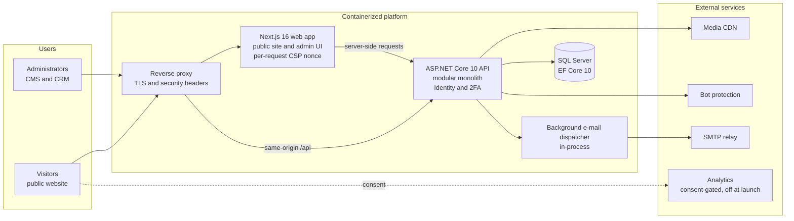

# Architecture

This is an abstracted view. Hostnames, network layout, container names, ports, hosting provider and operational procedures are intentionally omitted.

## Overview

## Backend: a modular monolith

One deployable ASP.NET Core 10 API, split into three projects with a strict dependency direction:

| Project | Responsibility | Depends on |
|---|---|---|
| Api | HTTP host, composition root, controllers, authentication and authorization, OpenAPI | Core, Infrastructure |
| Core | Domain models, contracts and business rules | Nothing project-specific |
| Infrastructure | EF Core and Identity persistence, media, bot protection, PDF rendering, e-mail | Core |

Business areas (catalog, content, portfolio, leads, customers, events, appointments, quotations, payments, notifications, auditing) are organized as modules inside these projects rather than as separate services.

## Frontend

A Next.js 16 App Router application serves both the public website and the admin UI. The public pages are rendered on the server for SEO; the admin area is a separate surface with its own, stricter Content-Security-Policy. The web application talks to the API only through the versioned HTTP API under `/api/v1`.

## Request flow

1. The browser reaches the reverse proxy over TLS.
2. Page requests go to the Next.js application, which issues a fresh CSP nonce per document.
3. API requests stay on the same origin (`/api/...`) and are routed to the ASP.NET Core API, so no cross-origin access is enabled by default.
4. Authentication uses an HttpOnly cookie; every state-changing request carries an antiforgery token.
5. The API validates, applies business rules, and persists through EF Core to SQL Server.

## Data and media

- SQL Server holds the business data; schema changes ship as EF Core migrations, and CI verifies that the migrations match the model.
- Public images and video are stored at a media CDN without their embedded metadata.
- Private images (reference photos attached to quote requests, payment receipts) are never public; they are streamed only to signed-in administrators through the API.
- Quotation PDFs are rendered on demand and not stored.

## Background work

Notification e-mails are written in the same database transaction as the request that causes them, then delivered by an in-process background dispatcher through a provider-neutral SMTP adapter. Delivery is at least once, with a stable message identifier.

## Environments

| Environment | Purpose |
|---|---|
| Development | Local work with development-only switches and a local e-mail outbox |
| CI | Throwaway SQL Server containers and generated per-run test databases |
| Staging | Production-like configuration, staging acceptance checks and user acceptance testing |
| Production | The public website and the admin area |

Outside development, the API refuses to start when a development-only switch is left on or a required production setting is missing, and the web application refuses to build or start without its required settings.
